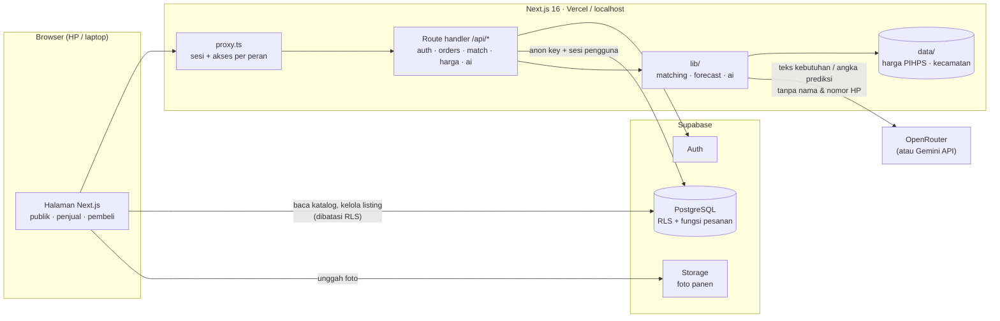
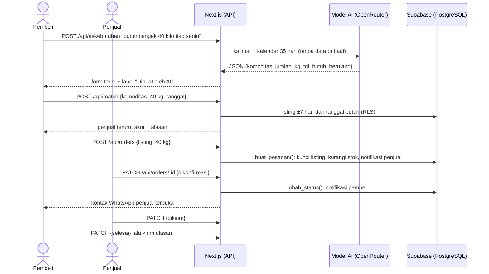
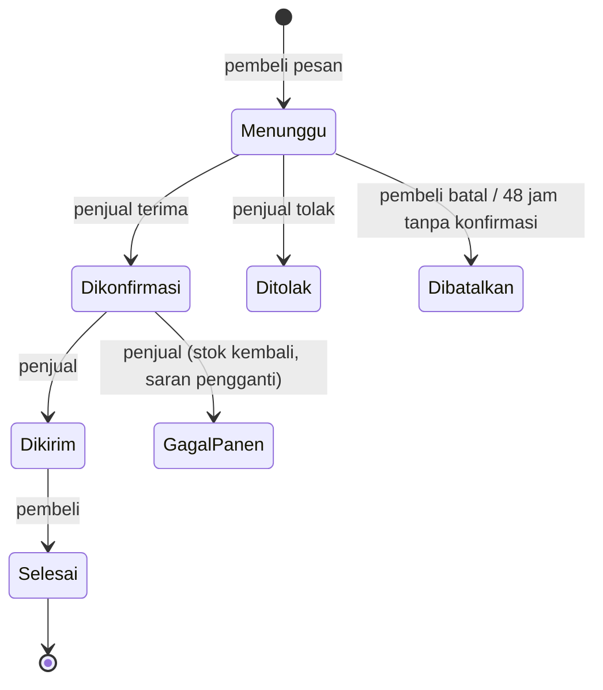

<p align="center">
  
</p>

<h1 align="center">PanenPasti</h1>

<p align="center">
  <b>Pre-order hasil panen yang adil, bukan ijon.</b><br>
  Aplikasi web yang mempertemukan petani dengan pelaku usaha kuliner sebelum panen terjadi,<br>
  lewat kalender panen, pencocokan otomatis, prediksi harga, dan asisten AI.
</p>

<p align="center">
  LOGICODIX 2026 Hackathon · Kategori <b>Web</b> · Subtema <b>Local MSME &amp; Creative Economy</b>
</p>

| | |
| --- | --- |
| Aplikasi (deploy) | **https://panenpasti.vercel.app** |
| Video demo | _[ISI URL YOUTUBE]_ |
| Repositori | https://github.com/dhanesmd3/PanenPasti |

---

## Daftar isi

1. [Tim](#tim)
2. [Deskripsi solusi](#deskripsi-solusi)
3. [Masalah yang diangkat](#masalah-yang-diangkat)
4. [Target pengguna](#target-pengguna)
5. [Fitur yang berhasil diimplementasikan](#fitur-yang-berhasil-diimplementasikan)
6. [Teknologi](#teknologi)
7. [Arsitektur sistem dan alur data](#arsitektur-sistem-dan-alur-data)
8. [Menjalankan secara lokal](#menjalankan-secara-lokal)
9. [Variabel lingkungan](#variabel-lingkungan)
10. [Akun demonstrasi](#akun-demonstrasi)
11. [Dokumentasi penggunaan AI](#dokumentasi-penggunaan-ai)
12. [Keamanan, privasi, dan efisiensi](#keamanan-privasi-dan-efisiensi)
13. [Pengujian](#pengujian)
14. [Atribusi](#atribusi)
15. [Dokumen lain](#dokumen-lain)

---

## Tim

**Nama tim:** Cumlaude

| Nama | Peran | Tanggung jawab utama | GitHub |
| --- | --- | --- | --- |
| Ghaniyul Amri Caulava (Ghaniyul) | A · Backend & Tech Lead | Skema database, Row Level Security, fungsi pesanan yang mengunci stok, autentikasi, API pesanan/notifikasi/surplus, pembatalan otomatis 48 jam, Supabase lokal, test database | [@ghaniyul](https://github.com/ghaniyul) |
| Malik Arsyafiandra Madani (Malik) | B · Frontend Penjual | Halaman penjual: beranda, catat panen, pesanan masuk, harga, gagal panen, surplus; tur panduan, akun demo, harga acuan pasar, adapter OpenRouter | [@malik00](https://github.com/malik00) |
| Axeleon Justin Algianto (Axeleon) | C · Frontend Pembeli & UI Kit | UI kit dan tema; landing, masuk, daftar, tentang; halaman pembeli: katalog, cari pemasok, pesanan, notifikasi, alert surplus, penjual pengganti; ulasan; filter harga; tampilan ramah lansia | [@angseleong](https://github.com/angseleong) |
| Dhanesworo Muhammad Datiputro (Dhanes) | D · AI, Data & Dokumen | Data harga dan wilayah, matching, prediksi harga, fitur AI, logo, profil & pengaturan, README | [@dhanesmd3](https://github.com/dhanesmd3) |

---

## Deskripsi solusi

**PanenPasti** menghubungkan dua kelompok UMKM:

- **Penjual:** UMKM tani, yaitu kelompok tani, koperasi, atau petani.
- **Pembeli:** UMKM kuliner, yaitu warung makan, resto kecil, dan katering.

Caranya lewat **pre-order hasil panen**. Penjual mencatat perkiraan panennya (jumlah, tanggal, harga yang ia tentukan sendiri). Pembeli menulis kebutuhannya dengan kalimat biasa, misalnya *"butuh cengek 40 kilo tiap Senin"*. Sistem lalu mencocokkan keduanya berdasarkan tanggal panen, jumlah stok, dan jarak, **sebelum panen terjadi**.

Bedanya dengan **ijon**: di ijon petani terikat utang dan harganya ditentukan pemberi pinjaman. Di PanenPasti, **harga ditentukan penjual**, terlihat jelas di depan, dan dibantu prediksi harga dari data resmi supaya penjual tidak menjual terlalu murah.

**Cakupan.** PanenPasti dirancang untuk semua jenis hasil panen dan semua daerah. Untuk MVP ini kami memakai **data nyata cabai rawit merah**: penjual di **Kab. Garut** (penghasil cabai rawit terbesar di Jawa Barat) dan pembeli di **Kota Bandung**. Katalog demo juga memuat enam komoditas hortikultura Garut lain (cabai merah keriting, tomat, kentang, kubis, wortel, bawang merah). Prediksi harga sementara hanya untuk cabai rawit, karena hanya komoditas itu yang data hariannya kami miliki.

---

## Masalah yang diangkat

**Petani menjual murah, pembeli membeli mahal, padahal jaraknya dekat.**

| Fakta | Sumber |
| --- | --- |
| Oktober 2026: harga cabai rawit di **petani turun ke Rp42.000–50.000/kg**, sementara di **konsumen menembus Rp100.000/kg** | [detikFinance, 25 Okt 2026](https://finance.detik.com/berita-ekonomi-bisnis/d-8723492/petani-ungkap-biang-kerok-harga-cabai-masih-mahal/amp) |
| Data PIHPS Bank Indonesia yang kami olah: rata-rata Desember 2025, harga produsen Kab. Garut **Rp20.000/kg** vs pasar tradisional Kota Bandung **Rp82.213/kg** (selisih +311%) | [`data/harga`](data/harga/cabai_rawit_merah_pihps.csv), PIHPS Nasional |
| Saat panen raya, harga di petani bisa jatuh di bawah biaya produksi, misalnya **Rp15.000/kg** di Balangan (Juli 2026) | [Radar Banjarmasin, 12 Jul 2026](https://radarbanjarmasin.jawapos.com/banua/2607120010/harga-cabai-anjlok-jadi-rp15-ribu-petani-balangan-harapkan-solusi-pemerintah) |
| Warung makan: cabai rawit naik dari Rp40.000 ke Rp70.000/kg, **keuntungan terpangkas hingga 50%** | [Disway Malang, 23 Sep 2026](https://malang.disway.id/malang-melintang/read/23136/lonjakan-harga-cabai-jerat-pedagang-warung-makan-di-malang-omzet-merosot-hingga-50-persen) |
| Cabai rawit jadi penyumbang inflasi terbesar September 2026 | [Medcom](https://www.medcom.id/ekonomi/makro/xkEdPZeb-inflasi-september-2026-tembus-0-30-cabai-rawit-jadi-penyumbang-terbesar) |

**Akar masalahnya sama di kedua sisi:** rantai distribusi panjang, dan tidak ada informasi bersama soal *kapan* dan *di mana* panen terjadi.

- **Petani** menanam tanpa kepastian pembeli dan tanpa informasi harga, lalu terpaksa menjual ke tengkulak atau terikat ijon.
- **Pemilik warung** tidak punya akses langsung ke sumber. Saat harga melonjak, mereka memangkas porsi atau menanggung rugi.

Jarak garis lurus Kab. Garut ke Kota Bandung hanya 26–93 km ([`data/kecamatan.csv`](data/kecamatan.csv)), tapi keduanya tidak pernah terhubung langsung. Data lengkap dan seluruh sumber ada di [PRD bagian 2–3](docs/PRD%20PanenPasti%20v2.md#2-latar-belakang--masalah).

---

## Target pengguna

| Sisi | Siapa | Kebutuhan utama |
| --- | --- | --- |
| **Penjual** | Ketua kelompok tani, admin koperasi, petani | Kepastian pembeli sebelum panen, harga jual yang layak, cara pakai yang sederhana |
| **Pembeli** | Pemilik warung makan, resto kecil, katering | Pasokan rutin, harga jelas di depan, sumber langsung yang dekat |

Banyak penjual tidak terbiasa dengan aplikasi, jadi tampilan dibuat untuk **pengguna awam dan lansia**: font Atkinson Hyperlegible yang mudah dibaca, kontras tinggi, tombol besar, menu sedikit, pilihan ukuran teks, tur panduan, dan pengisian form cukup dengan satu kalimat (dibantu AI).

---

## Fitur yang berhasil diimplementasikan

Semua fitur di bawah sudah berjalan di commit final dan diuji (lihat [Pengujian](#pengujian)).

**Akun dan akses**
- [x] Daftar dan masuk dengan peran **Penjual** atau **Pembeli**, dibatasi percobaan login (rate limit).
- [x] Tombol **"Coba akun demo"** di halaman Masuk.
- [x] Halaman dibatasi per peran (penjual tidak bisa membuka halaman pembeli, dan sebaliknya).
- [x] **Profil**: ubah nama, nama usaha, kecamatan, nomor WhatsApp.
- [x] **Pengaturan**: ukuran teks (Normal/Besar/Sangat besar), ganti kata sandi (wajib sandi lama), keluar.

**Sisi penjual**
- [x] **Catat panen**: tambah, ubah, hapus listing, termasuk foto (Supabase Storage). Bisa diisi otomatis oleh **AI-2**.
- [x] **Saran harga** dari prediksi untuk minggu panen yang dipilih.
- [x] **Halaman Harga**: grafik 26 minggu ke belakang + perkiraan 4 minggu ke depan dengan rentang 80%, dan penjelasan **AI-3**.
- [x] **Pesanan masuk**: terima, tolak, tandai dikirim.
- [x] **Gagal panen**: batalkan pesanan dengan alasan, stok dikembalikan, pembeli langsung diberi **saran penjual pengganti**.
- [x] **Alert surplus**: tandai panen berlebih dengan harga diskon, pembeli di Kota Bandung mendapat notifikasi.
- [x] Membalas **ulasan** pembeli.

**Sisi pembeli**
- [x] **Cari pemasok**: tulis kebutuhan dengan kalimat bebas (**AI-1**), lalu **pencocokan otomatis** dengan skor dan alasan.
- [x] **Katalog musiman**: filter komoditas, rentang tanggal panen, kecamatan, rentang harga, dan urutan. Ada **harga acuan pasar** sebagai pembanding.
- [x] **Pre-order** dengan stok yang dikunci di database, sehingga dua pesanan bersamaan tidak membuat stok minus.
- [x] **Pesanan**: lihat status, batalkan selama belum dikonfirmasi, tandai selesai, beri **ulasan bintang 1–5**.

**Bersama**
- [x] **Status pesanan**: Menunggu → Dikonfirmasi → Dikirim → Selesai, plus Ditolak / Dibatalkan / Gagal panen.
- [x] Pesanan yang **48 jam** tidak dikonfirmasi otomatis dibatalkan, dan stok kembali.
- [x] **Kontak WhatsApp** pihak lawan baru terbuka setelah pesanan dikonfirmasi.
- [x] **Notifikasi in-app** dengan lonceng dan jumlah belum dibaca.
- [x] **Tur panduan** interaktif untuk pengunjung baru, penjual, dan pembeli. Bisa dilewati dan diulang.
- [x] Halaman **Tentang & Privasi**: data apa yang dikirim ke AI, sumber data, dan batasan prediksi.

**Fitur AI** (rincian di [Dokumentasi penggunaan AI](#dokumentasi-penggunaan-ai))
- [x] **AI-1** Kebutuhan dari kalimat bebas, termasuk bahasa sehari-hari dan Sunda ("cengek", "kol").
- [x] **AI-2** Isi form panen dari satu kalimat ("3 kwintal" jadi 300 kg).
- [x] **AI-3** Penjelasan prediksi harga dalam bahasa sehari-hari, dengan pengaman angka.

---

## Teknologi

| Lapisan | Teknologi | Dipakai untuk |
| --- | --- | --- |
| Framework | **Next.js 16.4** (App Router, Turbopack, Cache Components), **React 19.3**, **TypeScript 5** | Halaman dan API dalam satu proyek |
| Tampilan | **Tailwind CSS 4**, font Fraunces + Atkinson Hyperlegible Next (Google Fonts) | Gaya, tipografi ramah lansia |
| Backend & database | **Supabase**: Auth, **PostgreSQL** dengan Row Level Security dan fungsi `plpgsql`, Storage | Akun, data, aturan akses, foto panen |
| Akses Supabase | `@supabase/ssr`, `@supabase/supabase-js` | Sesi lewat cookie di server dan browser |
| Validasi | **Zod 4** | Validasi input API dan keluaran AI (JSON Schema) |
| AI | **OpenRouter**, model `deepseek/deepseek-v4-flash-0731` (dipakai versi deploy). Alternatif: **Google Gemini API** (`@google/genai`), mis. `gemini-3.5-flash-lite`, praktis untuk lokal karena ada free tier | AI-1, AI-2, AI-3 |
| Data | PIHPS Nasional (Bank Indonesia), Wikidata | Harga historis cabai rawit, koordinat kecamatan |
| Pengujian | **Vitest 4**, **PGlite** (PostgreSQL di memori) | Unit test, test API, test migrasi dan RLS tanpa server |
| Deploy | **Vercel** + Supabase cloud. Cadangan: Supabase lokal via Docker | |

Matching dan prediksi harga ditulis sendiri dalam TypeScript ([`lib/matching.ts`](lib/matching.ts), [`lib/forecast.ts`](lib/forecast.ts)), tanpa layanan pihak ketiga.

---

## Arsitektur sistem dan alur data

### Arsitektur



- **Semua akses data memakai sesi pengguna**, sehingga tunduk pada Row Level Security. Service role key hanya dipakai skrip seed di laptop, tidak pernah di aplikasi.
- **Operasi penting dijalankan di database** lewat fungsi `security definer`: `buat_pesanan` (mengunci baris listing supaya stok tidak minus), `ubah_status`, `kontak_pesanan`, `tandai_surplus`, `batalkan_pesanan_kedaluwarsa`.
- **Prediksi harga dan matching** dihitung di server dari CSV yang ikut di-deploy, jadi tetap jalan walau database harga kosong.
- **AI hanya merapikan kata-kata.** Angka harga dan skor matching selalu dari kode.

### Alur data: dari kebutuhan sampai pesanan selesai



### Status pesanan



### Rumus inti

**Matching** ([`lib/matching.ts`](lib/matching.ts)):

```
skor = 100 × (0,5 · S_tanggal + 0,3 · S_jumlah + 0,2 · S_jarak)
```

Kandidat disaring: komoditas sama, stok tersisa, panen ±7 hari dari tanggal butuh, jarak ≤ 100 km (dihitung dengan rumus haversine dari koordinat kecamatan).

**Prediksi harga** ([`lib/forecast.ts`](lib/forecast.ts)): *mean reversion* mingguan, yaitu harga diasumsikan kembali pelan-pelan ke rata-rata 52 minggu:

```
prediksi(h) = μ₅₂ + (harga_terakhir − μ₅₂) · 0,9^h
```

Rentang 80% diambil dari sebaran galat backtest. Harga di tingkat petani = prediksi grosir Kota Bandung × rasio produsen Garut / grosir Bandung (rata-rata 90 hari, ≈ 0,8). Hasil backtest pada data PIHPS: galat rata-rata (MAPE) **9,2%** untuk 1 minggu ke depan dan **24,1%** untuk 4 minggu, dengan cakupan rentang 79–82%. Model yang lebih rumit (tren + musiman) sempat dicoba dan hasilnya 2× lebih buruk, jadi tidak dipakai. Detail di [PRD bagian 9.2](docs/PRD%20PanenPasti%20v2.md#92-prediksi-harga-f6-di-typescript).

### Struktur folder

```
app/                 Halaman (App Router) dan API (app/api/**/route.ts)
  (publik)/          Landing, masuk, daftar, tentang
  penjual/ pembeli/  Halaman per peran
  api/               auth, orders, match, harga, ai, notifikasi, profil, listings
components/          Komponen UI (ui/, penjual/, pembeli/, akun/)
lib/                 Logika: matching, forecast, ai/, pesanan, tanggal, supabase/
data/                CSV harga PIHPS, kecamatan, data seed simulasi
supabase/            Migrasi SQL, config Supabase lokal, test database
scripts/             Seed data simulasi, akun demo, impor harga
proxy.ts             Sesi + pembatasan halaman per peran (pengganti middleware di Next.js 16)
docs/                PRD, pembagian tugas, naskah video
```

---

## Menjalankan secara lokal

### Prasyarat

| Kebutuhan | Versi / catatan |
| --- | --- |
| Node.js | **22 atau lebih baru** (dibutuhkan `@google/genai`) |
| npm | bawaan Node.js |
| Database, pilih salah satu | **Docker Desktop** (Supabase lokal, disarankan) **atau** akun [Supabase](https://supabase.com) gratis |
| Kunci AI | **Opsional.** Kunci OpenRouter, atau kunci Gemini gratis dari [Google AI Studio](https://aistudio.google.com/apikey). Lihat [Soal kunci AI](#soal-kunci-ai-saat-dijalankan-lokal) |

### 1. Ambil kode dan pasang dependensi

```bash
git clone https://github.com/dhanesmd3/PanenPasti.git
cd PanenPasti
npm install
cp .env.example .env.local
```

### 2a. Database: Supabase lokal dengan Docker (disarankan)

Tidak perlu akun apa pun. Semua migrasi terpasang otomatis.

```bash
# Docker Desktop harus sudah berjalan
npx supabase start            # pertama kali mengunduh image Docker (beberapa GB)
npx supabase status -o env    # menampilkan URL dan key lokal
```

Salin tiga nilai dari `supabase status` ke `.env.local`:

| Di `.env.local` | Ambil dari `supabase status` |
| --- | --- |
| `NEXT_PUBLIC_SUPABASE_URL` | `API_URL` (biasanya `http://127.0.0.1:54321`) |
| `NEXT_PUBLIC_SUPABASE_ANON_KEY` | `ANON_KEY` |
| `SUPABASE_SERVICE_ROLE_KEY` | `SERVICE_ROLE_KEY` |

Dashboard database lokal (Supabase Studio) bisa dibuka di http://127.0.0.1:54323.

### 2b. Database: Supabase cloud (alternatif)

1. Buat project di [supabase.com](https://supabase.com), region Singapore.
2. Isi tiga variabel Supabase di `.env.local` dari **Project Settings → API**.
3. Pasang migrasi: `npx supabase login`, `npx supabase link --project-ref <ref>`, lalu `npx supabase db push`. Bisa juga menempel setiap file di [`supabase/migrations`](supabase/migrations) secara berurutan ke SQL Editor.
4. Di **Authentication → Sign In / Providers → Email**, matikan *Confirm email* supaya akun baru bisa langsung masuk.

Langkah lengkap ada di [`supabase/README.md`](supabase/README.md).

### 3. Isi data simulasi dan akun demo

```bash
npm run seed            # 7 komoditas, 72 kecamatan, 12 akun simulasi, 22 listing panen
npm run impor:harga     # opsional: 1.546 baris harga PIHPS ke tabel harga_historis
```

Tanggal panen di data simulasi dihitung relatif dari hari ini, jadi jalankan `npm run seed` lagi kalau data terasa basi. Untuk mengatur ulang kata sandi akun demo saja tanpa menyentuh data lain: `npm run akun:demo`.

### 4. Jalankan aplikasi

```bash
npm run dev                     # mode pengembangan
# atau, seperti saat Grand Final:
npm run build && npm start      # mode produksi
```

Buka **http://localhost:3000**, lalu masuk dengan [akun demonstrasi](#akun-demonstrasi).

### 5. Periksa (opsional)

```bash
npm test               # seluruh unit test, test API, dan test migrasi (tanpa server)
npm run typecheck
npm run lint
npm run uji:supabase   # 30 pemeriksaan RLS, privasi, dan konkurensi ke database yang sedang dipakai
```

### Soal kunci AI saat dijalankan lokal

Fitur AI memanggil model AI lewat internet (OpenRouter atau Gemini API), jadi butuh kunci API. Ada tiga kemungkinan:

| Kondisi | Yang terjadi |
| --- | --- |
| **Kunci diisi** (`OPENROUTER_API_KEY` + `OPENROUTER_MODEL`, atau `GEMINI_API_KEY` + `GEMINI_MODEL`) | AI-1, AI-2, AI-3 berjalan penuh |
| **Kunci kosong** | Aplikasi **tetap berjalan normal**. AI-1 dan AI-2 menampilkan pesan "Asisten AI belum aktif" lalu pengguna mengisi form secara manual. AI-3 otomatis memakai kalimat template dari angka prediksi. Matching, prediksi harga, pre-order, dan semua fitur lain tidak terpengaruh |
| **Tanpa internet** | Sama seperti kunci kosong. Dengan Supabase lokal, seluruh aplikasi selain AI tetap bisa dipakai offline |

**Opsi A: OpenRouter** (sama seperti versi deploy)

1. Buat kunci di [openrouter.ai/keys](https://openrouter.ai/keys).
2. Di `.env.local`, isi:
   ```env
   AI_PROVIDER=openrouter
   OPENROUTER_API_KEY=<kunci Anda>
   OPENROUTER_MODEL=deepseek/deepseek-v4-flash-0731
   ```
3. Jalankan ulang `npm run dev`.

**Opsi B: Gemini API**, bisa **gratis** (tanpa kartu kredit, tanpa billing):

1. Buka [Google AI Studio → API keys](https://aistudio.google.com/apikey), masuk dengan akun Google.
2. Klik **Create API key**, salin kuncinya.
3. Di `.env.local`, isi:
   ```env
   AI_PROVIDER=gemini
   GEMINI_API_KEY=<kunci Anda>
   GEMINI_MODEL=gemini-3.5-flash-lite
   ```
4. Jalankan ulang `npm run dev`.

Catatan free tier: batas pemakaiannya ditentukan Google per project, dan konten yang dikirim lewat free tier dapat dipakai Google untuk meningkatkan produknya. Karena itu aplikasi **tidak pernah mengirim nama, nomor HP, atau email** ke AI.

**Versi deploy** (URL di atas) sudah memakai kunci AI milik tim, jadi juri bisa mencoba semua fitur AI tanpa menyiapkan apa pun dan tanpa biaya. Tim menjaga kunci dan kuotanya tetap aktif selama masa penilaian.

---

## Variabel lingkungan

Contoh lengkap ada di [`.env.example`](.env.example). Salin menjadi `.env.local` (tidak ikut di-commit).

| Variabel | Wajib | Keterangan |
| --- | --- | --- |
| `NEXT_PUBLIC_SUPABASE_URL` | Ya | URL project Supabase (lokal atau cloud) |
| `NEXT_PUBLIC_SUPABASE_ANON_KEY` | Ya | Anon key Supabase. Aman di browser karena data dijaga RLS |
| `SUPABASE_SERVICE_ROLE_KEY` | Untuk skrip | Hanya untuk `npm run seed`, `akun:demo`, `impor:harga`, `uji:supabase`. **Jangan** diisi di Vercel dan jangan diawali `NEXT_PUBLIC_` |
| `DEMO_PASSWORD` | Tidak | Kata sandi akun demo (default `PanenPasti-Demo-2026`). Kalau diisi di server, halaman Masuk menampilkan tombol "Coba akun demo" |
| `AI_PROVIDER` | Tidak | `openrouter` (dipakai versi deploy) atau `gemini` (default kalau kosong) |
| `OPENROUTER_API_KEY`, `OPENROUTER_MODEL` | Untuk AI | Dipakai jika `AI_PROVIDER=openrouter` |
| `GEMINI_API_KEY`, `GEMINI_MODEL` | Untuk AI | Dipakai jika `AI_PROVIDER=gemini`, mis. model `gemini-3.5-flash-lite` |
| `AI_RATE_LIMIT_PER_HOUR` | Tidak | Batas panggilan AI per pengguna per jam (default 20) |
| `NEXT_PUBLIC_APP_URL` | Tidak | URL aplikasi, mis. `http://localhost:3000` |
| `NEXT_PUBLIC_VIDEO_TUTORIAL_PENJUAL`, `..._PEMBELI` | Tidak | Video opsional untuk tur panduan (URL YouTube atau path di `public/`) |

`GROQ_*` dan `ANTHROPIC_*` di `.env.example` disiapkan untuk adapter berikutnya dan belum dipakai.

---

## Akun demonstrasi

| Peran | Email | Kata sandi | Persona |
| --- | --- | --- | --- |
| **Penjual** | `penjual.demo@example.com` | `PanenPasti-Demo-2026` | Asep Saepudin, Kelompok Tani Pasir Hejo, Cikajang (Kab. Garut) |
| **Pembeli** | `pembeli.demo@example.com` | `PanenPasti-Demo-2026` | Siti Nurhaliza, Warung Nasi Teh Siti (Kota Bandung) |

Di halaman **Masuk** juga tersedia tombol **"Coba akun demo"** untuk masuk tanpa mengetik kata sandi.

Semua nama, usaha, nomor HP, dan listing di akun demo adalah **data simulasi** (fiktif, berlabel "Simulasi"). Harga komoditas selain cabai rawit hanya perkiraan untuk demo. Harga cabai rawit dan prediksinya memakai data asli PIHPS.

Skenario singkat untuk mencoba:

1. Masuk sebagai **pembeli** → **Cari Pemasok** → ketik `butuh cengek 40 kilo tiap senin` → tekan tombol AI → **Cari** → pesan dari Kelompok Tani Pasir Hejo.
2. Masuk sebagai **penjual** (jendela incognito) → lonceng notifikasi → **Pesanan** → **Terima**. Di sisi pembeli, tombol WhatsApp kini muncul.
3. Penjual → **Panen → Tambah panen** → ketik `panen 2 minggu lagi kira-kira 3 kwintal, super, 45 rebu` → tekan tombol AI. Lihat saran harga, lalu buka halaman **Harga**.

---

## Dokumentasi penggunaan AI

Sesuai ketentuan guidebook, bagian ini menjelaskan layanan dan model AI yang dipakai, bagian produk yang memanfaatkannya, dan pemakaian AI selama pengembangan.

### AI di dalam aplikasi

**Layanan:** OpenRouter (API chat completions). **Model:** `deepseek/deepseek-v4-flash-0731` (diatur lewat `OPENROUTER_MODEL`). Provider bisa diganti ke Google Gemini API (mis. `gemini-3.5-flash-lite`) lewat `AI_PROVIDER` tanpa mengubah kode fitur ([`lib/ai/provider.ts`](lib/ai/provider.ts)).

| Fitur | Untuk siapa | Masukan → keluaran | Endpoint & kode | Data yang dikirim ke AI |
| --- | --- | --- | --- | --- |
| **AI-1** Kebutuhan dari kalimat bebas | Pembeli | "butuh cengek 40 kilo tiap senin" → `{komoditas, jumlah_kg, tgl_butuh, berulang}` | `POST /api/ai/kebutuhan` · [`lib/ai/fitur/kebutuhan.ts`](lib/ai/fitur/kebutuhan.ts) | Teks kebutuhan + kalender 35 hari ke depan |
| **AI-2** Isi form panen | Penjual | "3 kwintal panen 2 minggu lagi, super, 45 rebu" → `{komoditas, jumlah_kg, tgl_panen, kualitas, harga_per_kg}` | `POST /api/ai/listing` · [`lib/ai/fitur/listing.ts`](lib/ai/fitur/listing.ts) | Teks panen + kalender 70 hari ke depan |
| **AI-3** Penjelasan harga | Penjual | Angka prediksi → 2–3 kalimat saran jual | `POST /api/ai/penjelasan-harga` · [`lib/ai/fitur/penjelasan-harga.ts`](lib/ai/fitur/penjelasan-harga.ts) | Hanya angka harga, tanggal minggu panen, dan saran sistem |

**Pengaman yang diterapkan:**

- **Keluaran terstruktur dan divalidasi.** AI diminta menjawab dalam JSON sesuai skema, lalu dicek ulang dengan Zod. Jawaban yang tidak sesuai ditolak.
- **Tidak mengarang.** Informasi yang tidak disebut pengguna diisi `null`, dan pengguna diminta melengkapinya.
- **Daftar komoditas dikunci.** AI hanya boleh memilih dari 7 komoditas yang tersedia. Komoditas lain ditolak dengan pesan yang jelas.
- **Tanggal dari kalender.** Model bahasa sering salah menghitung tanggal, jadi prompt menyertakan kalender eksplisit, dan tanggal di luar rentang wajar dibuang.
- **Angka dijaga.** Jumlah dan harga di luar rentang wajar per komoditas dibuang. Untuk AI-3, setiap angka di kalimat AI harus sama dengan hasil hitungan. Kalau tidak, kalimat AI dibuang dan diganti template yang pasti benar.
- **AI tidak menghitung harga.** Prediksi dan skor matching sepenuhnya dari kode ([`lib/forecast.ts`](lib/forecast.ts), [`lib/matching.ts`](lib/matching.ts)).
- **Transparan ke pengguna.** Setiap hasil AI diberi label *"Dibuat oleh AI — periksa sebelum disimpan"*. Prediksi diberi disclaimer *"Perkiraan, bukan jaminan"*. Halaman **Tentang & Privasi** menjelaskan data apa yang dikirim ke AI.
- **Selalu ada jalan tanpa AI.** Jika AI gagal, kuota habis, atau kunci kosong, form manual tetap bisa dipakai.
- **Hemat sumber daya.** Batas 20 panggilan AI per pengguna per jam, hasil AI-3 di-cache 6 jam, dan model yang dipakai adalah versi Flash-Lite yang ringan.
- **Privasi.** Nama, email, dan nomor HP tidak pernah dikirim ke AI.

### AI selama pengembangan (AI coding assistant)

Guidebook mengizinkan AI coding assistant, dengan syarat tim memahami dan bertanggung jawab atas seluruh kode. Seluruh anggota memakai **Claude Code** (Anthropic, model **Claude Opus**). Pemakaiannya mengikuti tugas masing-masing di riwayat commit GitHub:

| Anggota | Alat | Dipakai untuk |
| --- | --- | --- |
| Ghaniyul (A) | Claude Code (Claude Opus) | Skema database dan Row Level Security; fungsi pesanan yang mengunci stok; aturan status pesanan, kontak setelah konfirmasi, surplus, pembatalan otomatis 48 jam; endpoint auth, profil, pesanan, notifikasi; konfigurasi Supabase lokal; test migrasi di PGlite dan test route handler; dokumentasi backend |
| Malik (B) | Claude Code (Claude Opus) | Layout dan navigasi penjual; daftar dan form panen; halaman surplus, pesanan masuk, gagal panen; halaman harga dan beranda penjual; tur panduan sorotan; tombol akun demo; harga acuan pasar; adapter provider OpenRouter |
| Axeleon (C) | Claude Code (Claude Opus) | UI kit dan tema warna; landing, masuk, daftar, tentang & privasi; halaman pembeli (beranda, katalog, detail, pre-order, cari pemasok dengan AI, pesanan); notifikasi; alert surplus; saran penjual pengganti; tabel dan tampilan ulasan; filter harga; tampilan ramah lansia |
| Dhanes (D) | Claude Code (Claude Opus) | Draf PRD dan pembagian tugas; pengambilan data PIHPS dan Wikidata; matching dan API-nya; prediksi harga beserta backtest; fitur AI-1/2/3 dan pengamannya; API harga; seed data; komoditas tambahan dan foto komoditas; profil & pengaturan; logo; naskah video; README |

Beberapa commit mencantumkan Claude sebagai co-author.

Seluruh keluaran AI coding assistant ditinjau, dijalankan, dan diuji oleh anggota tim sebelum di-commit. Keputusan produk, pemilihan data, dan desain solusi ditentukan tim.

---

## Keamanan, privasi, dan efisiensi

**Keamanan**
- **Row Level Security** di semua tabel: pengguna hanya bisa membaca dan mengubah data miliknya, sesuai perannya.
- Operasi yang mengubah stok dan status pesanan hanya lewat fungsi database, bukan tulis langsung ke tabel.
- Rate limit untuk login, pendaftaran, ganti kata sandi, dan panggilan AI.
- Ganti kata sandi wajib memasukkan kata sandi lama.
- Kredensial hanya di `.env.local` (masuk `.gitignore`). Repositori hanya berisi [`.env.example`](.env.example).

**Privasi**
- Nomor HP **tidak bisa dibaca** pengguna lain (dicabut di level kolom). Kontak WhatsApp baru terbuka untuk kedua pihak setelah pesanan dikonfirmasi.
- Data pribadi tidak dikirim ke AI.
- Data demo seluruhnya fiktif.

**Efisiensi sumber daya**
- Prediksi harga dihitung dari CSV kecil yang ikut di-deploy, tanpa layanan tambahan.
- Hasil prediksi dan penjelasan AI di-cache. Foto komoditas dikompres ke WebP (total ±270 KB untuk 7 foto).
- Model AI yang dipakai adalah versi ringan, dan hanya dipanggil saat pengguna menekan tombol AI.

---

## Pengujian

```bash
npm test
```

- **Unit test** untuk matching, prediksi harga, tanggal, skema validasi, fitur AI (dengan provider palsu, tanpa memanggil API), komoditas, dan aturan akses.
- **Test API** untuk route handler akun, pesanan, dan notifikasi.
- **Test database** yang menjalankan seluruh migrasi asli di **PGlite** (PostgreSQL di memori): RLS, privasi nomor HP, fungsi pesanan, surplus, dan ulasan.
- `npm run uji:supabase` menjalankan 30 pemeriksaan tambahan ke database sungguhan (lokal atau cloud), termasuk dua pesanan yang benar-benar bersamaan pada stok yang sama.

---

## Atribusi

**Data**

| Sumber | Dipakai untuk | Lisensi / ketentuan |
| --- | --- | --- |
| [PIHPS Nasional, Bank Indonesia](https://www.bi.go.id/hargapangan) | Harga harian cabai rawit merah 1 Nov 2024 – 6 Nov 2026 (produsen Kab. Garut; pedagang besar dan pasar tradisional Kota Bandung) di [`data/harga`](data/harga) | Hak cipta PIHPS Nasional. Dipakai non-komersial untuk lomba dengan atribusi ke Bank Indonesia. Detail di [`data/README.md`](data/README.md) |
| [Wikidata](https://www.wikidata.org) | Daftar dan koordinat 72 kecamatan Kab. Garut dan Kota Bandung di [`data/kecamatan.csv`](data/kecamatan.csv) | CC0 |
| Berita di bagian [Masalah](#masalah-yang-diangkat) dan di [PRD bagian 3](docs/PRD%20PanenPasti%20v2.md#3-data--berita-pendukung) | Bukti masalah | Dikutip dengan tautan ke sumber asli |

**Aset**

| Sumber | Dipakai untuk | Lisensi / ketentuan |
| --- | --- | --- |
| Foto komoditas dari [Pexels](https://www.pexels.com) (`public/komoditas/`): [cabai rawit](https://www.pexels.com/photo/21273622/) oleh Terrance Barksdale, [cabai merah keriting](https://www.pexels.com/photo/2893882/) oleh Mark Stebnicki, [tomat](https://www.pexels.com/photo/10112127/) oleh Engin Akyurt, [kentang](https://www.pexels.com/photo/7129145/) oleh Michael Burrows, [kubis](https://www.pexels.com/photo/134877/) oleh freestocks.org, [wortel](https://www.pexels.com/photo/20371247/) oleh Javier Balseiro, [bawang merah](https://www.pexels.com/photo/144206/) oleh Miguel Á. Padriñán | Gambar pengganti di katalog saat penjual belum mengunggah foto (dipotong persegi, dikompres ke WebP) | [Lisensi Pexels](https://www.pexels.com/license/): bebas dipakai, atribusi tidak wajib |
| [Fraunces](https://fonts.google.com/specimen/Fraunces) dan [Atkinson Hyperlegible Next](https://fonts.google.com/specimen/Atkinson+Hyperlegible+Next) via Google Fonts | Huruf judul dan huruf isi | SIL Open Font License 1.1 |
| Logo, ikon, dan ilustrasi SVG (ladang, komoditas cadangan) | Identitas dan tampilan aplikasi | Dibuat oleh tim (logo dirancang dengan bantuan Claude Code) |

**Kode dan library**

| Sumber | Dipakai untuk | Lisensi |
| --- | --- | --- |
| [Next.js](https://nextjs.org) via `create-next-app` | Kerangka proyek awal dan framework | MIT |
| [React](https://react.dev) | UI | MIT |
| [Tailwind CSS](https://tailwindcss.com) | Styling | MIT |
| [Supabase](https://supabase.com) (`@supabase/ssr`, `@supabase/supabase-js`, Supabase CLI) | Auth, database, storage | MIT / Apache-2.0 |
| [`@google/genai`](https://github.com/googleapis/js-genai) | Klien Gemini API | Apache-2.0 |
| [Zod](https://zod.dev) | Validasi | MIT |
| [Vitest](https://vitest.dev) | Pengujian | MIT |
| [PGlite](https://pglite.dev) (`@electric-sql/pglite`) | PostgreSQL di memori untuk test | Apache-2.0 / PostgreSQL License |

Tidak ada template UI atau kode proyek lain yang dipakai. Seluruh halaman, komponen, migrasi, dan logika ditulis tim selama Hacking Week.

---

## Dokumen lain

- [PRD PanenPasti v2](docs/PRD%20PanenPasti%20v2.md): latar belakang, data, scope, logika matching dan prediksi, etika.
- [Pembagian tugas & timeline](docs/Pembagian%20Tugas%20dan%20Timeline.md)
- [Dokumentasi backend & API](supabase/README.md)
- [Sumber dan catatan data](data/README.md)
- [Naskah video demo](docs/Naskah%20Video%20Demo%20PanenPasti.docx)
