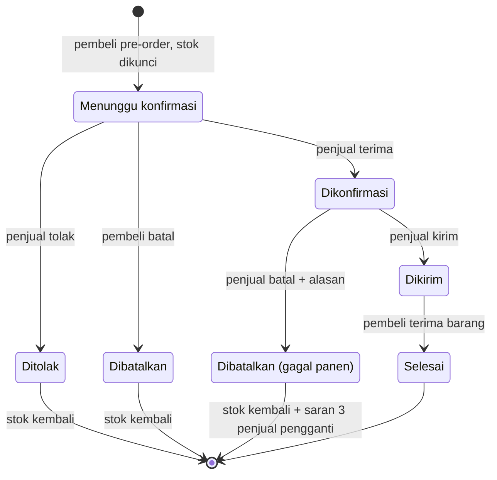
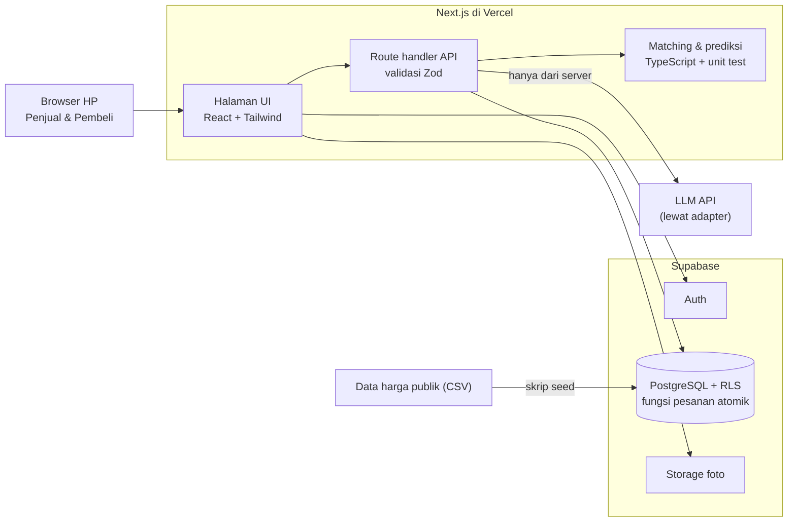

# PRD v2: PanenPasti

**Versi 2.1** · 7 November 2026 · dikembangkan dari PRD v1 (5 Nov 2026, @Axeleon)
**Lomba:** LOGICODIX 2026 Hackathon · Kategori **Web** · Subtema **Local MSME & Creative Economy**
**Nama aplikasi:** PanenPasti (nama sementara)

Pembagian tugas dan jadwal harian ada di file terpisah: [Pembagian Tugas dan Timeline.md](Pembagian%20Tugas%20dan%20Timeline.md).

---

## 0. Perubahan dari PRD v1

| Bagian | v1 | v2 |
| --- | --- | --- |
| Framing | Kesejahteraan petani | Dua sisi UMKM: akses pasar untuk UMKM tani, kepastian bahan baku untuk UMKM kuliner |
| Bukti masalah | Belum ada | Data harga dan berita 2026 yang sudah dicek ke sumbernya (bagian 3) |
| UI | Umum | Prinsip UI berbeda untuk penjual (sangat sederhana) dan pembeli (lebih lengkap) |
| AI | Prediksi harga dengan Python/Prophet | Tiga fitur AI. Prediksi dihitung di TypeScript, tanpa server Python. Pilihan provider gratis dan berbayar sudah dicek |
| Matching | Formula umum | Rumus berbobot yang konkret. Gabungan beberapa petani turun ke P1 |
| Prioritas | Alert surplus P1 | Alert surplus naik ke P0 karena inti cerita panen raya |
| Baru | — | Model bisnis, status pesanan & gagal panen, model data, arsitektur, etika & keamanan, checklist guidebook, skenario video |

---

## 1. Ringkasan

**PanenPasti** adalah aplikasi web yang menghubungkan dua kelompok UMKM:

- **UMKM tani**: koperasi atau kelompok tani.
- **UMKM kuliner**: warung, resto kecil, dan katering.

Caranya lewat **pre-order hasil panen**, **pencocokan otomatis berdasarkan kalender panen**, dan **asisten AI**.

**Ide inti:** musim panen bukan hambatan, tapi bahan utama solusi. UMKM kuliner memesan sebelum panen. Sistem mencocokkan pesanan dengan petani yang panennya jatuh di waktu yang tepat. AI membantu kedua pihak memutuskan.

**Kalimat pitch:** *pre-order yang adil, bukan ijon.* Pembeli memesan sebelum panen, tapi harganya transparan dan petani yang menentukan.

**Target waktu:**

- **12 Nov 2026:** semua fitur P0 jadi.
- **13 Nov:** video dan dokumen.
- **14 Nov:** submit. Code freeze pukul 23.59 WIB.

---

## 2. Latar Belakang & Masalah

**UMKM tani: akses pasar sempit**

- Petani menjual ke pengepul atau tengkulak, jadi harga di tingkat petani jauh di bawah harga konsumen.
- Saat panen raya, harga anjlok sampai di bawah biaya produksi.
- Ada petani yang terikat **ijon**: mengambil uang lebih dulu, lalu wajib menjual panen ke pemberi pinjaman dengan harga rendah.
- Petani menanam tanpa kepastian pembeli dan tanpa informasi harga.

**UMKM kuliner: bahan baku tidak pasti**

- Harga cabai melonjak tajam beberapa kali dalam setahun.
- Pemilik warung tidak berani menaikkan harga menu, jadi memangkas porsi atau menanggung rugi.
- Stok kosong di luar musim, dan tidak ada akses langsung ke sumber.

**Akar masalah yang sama:** rantai distribusi panjang dan tidak ada informasi bersama soal kapan dan di mana panen terjadi.

---

## 3. Data & Berita Pendukung

### 3.0 Data lokal: petani Garut vs pasar Kota Bandung

**Lokasi MVP:** penjual di **Kab. Garut**, penghasil cabai rawit terbesar di Jawa Barat. Pembeli di **Kota Bandung**, pusat UMKM kuliner.

Data harga cabai rawit merah dari PIHPS Bank Indonesia, 1 Nov 2024 – 6 Nov 2026, disimpan di [`data/harga/cabai_rawit_merah_pihps.csv`](../data/harga/cabai_rawit_merah_pihps.csv). Rata-rata bulanan:

| Bulan | Produsen Kab. Garut | Pasar tradisional Kota Bandung | Selisih |
| --- | --- | --- | --- |
| Des 2025 | Rp20.000 | Rp82.213 | +311% |
| Feb 2026 | Rp32.105 | Rp87.838 | +174% |
| Agu 2026 | Rp25.000 | Rp60.842 | +143% |
| Okt 2026 | Rp60.000 | Rp93.816 | +56% |

- Dalam 2 tahun, harga pasar Kota Bandung bergerak **Rp45.000–120.000/kg**. Harga produsen Garut bergerak **Rp20.000–80.000/kg**.
- Garut dan Kota Bandung adalah wilayah berbeda. Selisihnya menggambarkan jarak harga petani–konsumen, bukan margin satu rantai pasok yang terukur.
- Harga produsen Garut jarang diperbarui di PIHPS (berubah 18 kali dalam 2 tahun).

**Produksi:** Kab. Garut tercatat sebagai penghasil cabai rawit terbesar di Jawa Barat pada 2023, sekitar 651 ribu kuintal ([Ayo Bandung](https://www.ayobandung.com/umum/7913915452/inilah-8-daerah-penghasil-cabai-rawit-terbanyak-di-jawa-barat-kabupaten-ini-panen-hingga-651-ribu-kwintal), mengutip BPS). *Verifikasi di [Open Data Jabar](https://opendata.jabarprov.go.id/id/dataset/produksi-cabai-rawit-berdasarkan-kabupatenkota-di-jawa-barat) sebelum dipakai di slide.*

**Kenapa cabai:**

- Cepat busuk, jadi waktu jual menentukan.
- Penyumbang inflasi terbesar September 2026 ([Medcom](https://www.medcom.id/ekonomi/makro/xkEdPZeb-inflasi-september-2026-tembus-0-30-cabai-rawit-jadi-penyumbang-terbesar)) dan terbesar kedua untuk inflasi tahunan Oktober 2026 ([Antara](https://www.antaranews.com/berita/5825871/bps-harga-cabai-jadi-pemicu-inflasi-oktober-2026-capai-022-persen)).
- Dipakai hampir semua UMKM kuliner.
- Bisa dipanen berkali-kali dalam setahun.
- Data harganya tersedia di tingkat petani, grosir, dan konsumen.

Diurutkan dari yang terbaru. Semua tautan di bawah sudah dibuka dan angkanya dicek langsung ke artikel aslinya (7 Nov 2026), kecuali yang ditandai "perlu dicek".

### 3.1 Selisih harga petani vs konsumen

| Tanggal | Fakta | Sumber |
| --- | --- | --- |
| 31 Okt 2026 | Wamentan Muhammad Saleh Mustafa: harga cabai di tingkat petani "flat" sekitar **Rp45.000/kg**, sementara di Papua sampai **Rp250.000/kg** | [Monitor Indonesia](https://monitorindonesia.com/ekonomi/read/2026/10/637845/harga-cabai-di-papua-tembus-rp250-ribu-wamentan-dorong-bumd-turun-tangan) |
| 25 Okt 2026 | Asosiasi Champion Cabai Indonesia (ACCI): harga di petani **turun** dari ±Rp60.000 ke **Rp42.000–50.000/kg**, padahal cabai rawit merah di konsumen **menembus Rp100.000/kg** | [detikFinance](https://finance.detik.com/berita-ekonomi-bisnis/d-8723492/petani-ungkap-biang-kerok-harga-cabai-masih-mahal/amp) |
| 22 Sep 2026 | Kementan (Direktur Sayuran dan Tanaman Obat): harga di Jakarta **Rp100 ribu**, tapi cabai rawit merah di tingkat petani masih **Rp50–60 ribu/kg** | [RRI](https://rri.co.id/nasional/2750479/harga-cabai-petani-jauh-di-bawah-pasar) |
| 16 Feb 2026 | Panel Harga Pangan (14 Feb 2026): cabai rawit merah rata-rata nasional **Rp56.383/kg di produsen** vs **Rp73.339/kg di konsumen**, atau sekitar 30% lebih mahal di konsumen | [Metrotvnews](https://www.metrotvnews.com/read/kj2CD1pq-stabilisasi-harga-cabai-bapanas-gandeng-petani-pedagang-hingga-satgas) |

**Poin pitch:** pada Oktober 2026, harga di petani justru *turun* ke Rp42–50 ribu, sementara konsumen membayar Rp100 ribu. Selisihnya habis di rantai distribusi, bukan dinikmati petani.

### 3.2 Harga anjlok saat panen raya

| Tanggal | Fakta | Sumber |
| --- | --- | --- |
| 12 Jul 2026 | Balangan, Kalsel: cabai merah keriting di tingkat petani hanya **Rp15 ribu/kg**, "jauh di bawah biaya produksi" | [Radar Banjarmasin](https://radarbanjarmasin.jawapos.com/banua/2607120010/harga-cabai-anjlok-jadi-rp15-ribu-petani-balangan-harapkan-solusi-pemerintah) |
| 25 Apr 2026 | Toba, Sumut: petani menjual cabai rawit ke pengepul hanya **Rp10.000/kg**, sebulan sebelumnya sempat **Rp8.000/kg** | [Mistar.id](https://mistar.id/news/ekonomi/harga-cabai-anjlok-di-toba-petani-menjerit-jual-hanya-rp10-ribu-per-kg) |

Kedua kasus terjadi di tahun yang sama dengan harga konsumen yang menembus Rp100 ribu. Ini menunjukkan masalahnya ada di **waktu dan pencocokan pasokan**, bukan hanya jumlah produksi.

### 3.3 Dampak ke UMKM kuliner

| Tanggal | Fakta | Sumber |
| --- | --- | --- |
| 23 Sep 2026 | Warung makan di Malang: cabai rawit naik dari **Rp40.000 ke Rp70.000/kg**, keuntungan terpangkas **hingga 50%** | [Disway Malang](https://malang.disway.id/malang-melintang/read/23136/lonjakan-harga-cabai-jerat-pedagang-warung-makan-di-malang-omzet-merosot-hingga-50-persen) |
| 20 Sep 2026 | Koordinator Warteg Nusantara (Kowantara): cabai rawit merah **hampir Rp100.000/kg**, padahal harga ideal untuk warteg **Rp70.000–75.000/kg** | [detikFinance](https://finance.detik.com/berita-ekonomi-bisnis/d-8671495/pedagang-warteg-serba-salah-gara-gara-harga-cabai-mahal) |

### 3.4 Rantai distribusi & sisa pangan

| Fakta | Sumber |
| --- | --- |
| Bappenas: Indonesia membuang **23–48 juta ton** pangan per tahun (periode 2000–2019), dengan kerugian ekonomi **Rp213–551 triliun per tahun** | [Kontan, 3 Jul 2024](https://nasional.kontan.co.id/news/bappenas-catat-potensi-kerugian-akibat-sampah-makanan-capai-rp-551-triliun-per-tahun) |
| BPS menerbitkan *Distribusi Perdagangan Komoditas Cabai Merah di Indonesia 2022* (rilis 24 Okt 2022). Isinya pola distribusi dan Margin Perdagangan dan Pengangkutan (MPP) dari survei di 34 provinsi. **Unduh PDF-nya** untuk angka MPP terbaru | [BPS](https://www.bps.go.id/id/publication/2022/10/24/1c3eb22e94bf4523bc029d1b/distribusi-perdagangan-komoditas-cabai-merah-di-indonesia-2022.html) |

### 3.5 Perlu dicek sebelum dipakai di slide

Data di bawah muncul di hasil pencarian, tapi artikelnya belum berhasil dibuka atau dicek langsung.

- [ ] PIHPS: cabai merah rata-rata nasional Rp39.588/kg (akhir Jan 2026) naik ke Rp70.726/kg (akhir Mei 2026). [periskop.id](https://periskop.id/komoditas/20261021/menelaah-harga-cabai-merah-januariseptember-2026-begini-kondisi-antarprovinsi) (situs error saat dibuka)
- [ ] BPS (data 2019): pola utama distribusi cabai merah adalah petani → pedagang pengepul → pedagang eceran → konsumen, dengan MPP total 43,09%. Cek di PDF publikasi BPS.
- [ ] Warung di Palmerah mengurangi porsi lauk karena cabai mahal (awal Nov 2026). [Kompas.id](https://www.kompas.id/artikel/cabai-dan-tepung-naik-terus-keuntungan-pedagang-kian-tergerus) (berbayar)
- [ ] Warteg di Bekasi mengakali belanja dan mengurangi porsi (Jun 2026). [Kompas.com](https://megapolitan.kompas.com/read/2026/06/03/16324941/harga-bahan-pokok-naik-pedagang-warteg-di-bekasi-akali-belanja-hingga)
- [ ] Dompu, NTB: gabah dijual Rp5.500/kg, di bawah HPP Rp6.500, diduga karena ijon (Feb 2026). [SuaraNTB](https://suarantb.com/2026/02/04/diduga-terlilit-ijon-petani-dompu-jual-gabah-di-bawah-hpp/)
- [ ] Program KUR untuk petani jagung guna memutus rantai tengkulak (Mar 2026). [Sriwijaya Hari Ini](https://sriwijaya-hariini.com/2026/03/07/polri-gandeng-4-bank-himbara-salurkan-kur-bagi-petani-jagung-untuk-memutus-rantai-tengkulak/)

### 3.6 Bukti lapangan (dikerjakan tim)

- [ ] Wawancara 1–2 petani atau pengurus koperasi: harga jual ke pengepul, pernah ijon atau tidak, kapan harga paling anjlok.
- [ ] Wawancara 1–2 pemilik warung atau katering: belanja cabai per minggu, pernah kehabisan atau tidak, reaksi saat harga naik.
- [ ] Ambil 2–3 kutipan terkuat untuk landing page, README, dan slide.

---

## 4. Pengguna & Dua Sisi Aplikasi

Satu aplikasi web dengan dua peran. Saat daftar, pengguna memilih **Penjual** atau **Pembeli**, lalu melihat menu yang berbeda.

| Peran | Siapa | Kebutuhan utama | Masalah saat ini |
| --- | --- | --- | --- |
| Penjual (UMKM tani) | Ketua kelompok tani atau admin koperasi. Bisa pakai HP, tapi bukan pengguna aplikasi mahir. Menginput atas nama anggota | Pembeli pasti, harga adil, info kapan sebaiknya jual | Terikat pengepul atau tengkulak, harga tidak transparan |
| Pembeli (UMKM kuliner) | Pemilik warung makan, resto kecil, katering | Pasokan rutin, harga stabil, kualitas jelas | Harga naik-turun, stok kosong di luar musim |

**Halaman per peran**

| Halaman | Penjual | Pembeli |
| --- | --- | --- |
| Beranda | Jumlah pesanan baru, kartu harga satu kalimat, tombol Tambah Panen | Komoditas yang sedang/akan panen, alert surplus |
| Utama | **Panen Saya**: tambah/ubah/hapus, tombol "Isi dengan AI" | **Cari Pemasok**: ketik kebutuhan bebas, hasil matching berperingkat |
| Pesanan | **Pesanan Masuk**: terima, tolak, tandai dikirim, batalkan karena gagal panen | **Pesanan Saya**: status, kontak penjual setelah dikonfirmasi, tandai diterima |
| Khusus | **Harga Cabai**: saran jual dari AI + grafik di "Lihat detail"; tombol tandai surplus | Katalog musiman: filter komoditas, kecamatan, tanggal |
| Umum | Notifikasi, Profil | Notifikasi, Profil |

**Halaman publik:**

- Landing page: masalah, solusi, angka bukti, tombol masuk.
- Login/daftar.
- Tentang & Privasi.

---

## 5. Prinsip UI

**Keputusan:** UI penjual dibuat **sangat sederhana**. UI pembeli boleh lebih lengkap.

**Alasan:**

- Orang mau belajar aplikasi baru kalau untungnya jelas, ada yang mendampingi, dan pengalaman pertamanya tidak membingungkan. Contohnya merchant GoFood/ShopeeFood.
- Pendamping di sini adalah admin koperasi.
- UI/UX menyumbang 15% nilai lomba, dan kemudahan penggunaan termasuk yang dinilai.

### 5.1 Sisi penjual

- **Tiga menu utama** di navigasi bawah, dengan ikon besar dan label: *Panen*, *Pesanan*, *Harga*.
- **Satu layar, satu tugas.** Tidak ada tabel dan tidak ada filter berlapis.
- **Bahasa sehari-hari.** "Panen saya", bukan "Listing". "Pesanan masuk", bukan "Order management".
- **Input dibuat mudah:**
  - Kotak ketik bebas yang diisi AI (AI-2).
  - Pilihan tanggal cepat: "1 minggu lagi", "2 minggu lagi", "akhir bulan".
  - Satuan kg atau kuintal.
  - Stepper +/- untuk jumlah.
- **Status pesanan** memakai warna, ikon, dan teks sekaligus.
- **Info harga cukup satu kalimat** + panah naik/turun. Grafik disembunyikan di "Lihat detail".
- **Tombol besar:** tinggi minimal 48px, teks minimal 16px, tombol utama di bawah layar agar mudah dijangkau jempol.
- **Uji di lebar layar 360px** (HP Android murah).

```
┌──────────────────────────┐
│ Halo, Pak Darto          │
│                          │
│ 2 pesanan baru           │
│ [ Lihat Pesanan  → ]     │
│                          │
│ Harga cabai rawit        │
│ Rp36.000/kg  ↑ naik      │
│ "Perkiraan naik minggu   │
│  depan. Tahan dulu."     │
│                          │
│ [ + Tambah Panen ]       │
├──────────────────────────┤
│  Panen │ Pesanan │ Harga │
└──────────────────────────┘
```

### 5.2 Sisi pembeli

- Boleh ada filter, detail skor matching beserta alasannya, dan riwayat pesanan.
- Tetap mobile-first dan berbahasa Indonesia.

### 5.3 Roadmap UI

Fitur lanjutan untuk penjual (laporan pendapatan, grafik lengkap) dibuka bertahap setelah pengguna terbiasa. Fitur ini hanya untuk slide, tidak dibangun di MVP.

---

## 6. Tujuan, Metrik & Model Bisnis

**Tujuan produk**

1. Memperluas akses pasar UMKM tani dengan memotong rantai perantara.
2. Memberi UMKM kuliner kepastian pasokan dan harga bahan baku lewat pre-order.
3. Mengurangi hasil panen terbuang saat panen raya lewat alert surplus.
4. Membantu kedua pihak memutuskan dengan data harga dan asisten AI.

**Metrik keberhasilan** *(target pilot, perlu divalidasi)*

| Metrik | Cara ukur | Target pilot |
| --- | --- | --- |
| Kenaikan harga terima petani | Harga jual di platform vs harga pengepul | Lebih tinggi dari harga pengepul |
| Fill rate pre-order | Pesanan selesai / total pesanan dikonfirmasi | ≥ 80% |
| Surplus terserap | Volume surplus yang terjual lewat alert | Naik dibanding sebelum pakai platform |
| Pembeli berulang | Pembeli yang order lagi dalam 30 hari | ≥ 50% |

**Model bisnis** *(hipotesis, untuk Q&A juri)*

| Sumber pendapatan | Siapa bayar | Skema |
| --- | --- | --- |
| Komisi transaksi | Pembeli | Sekitar 3% dari nilai pesanan selesai. **Penjual tidak dipotong**, supaya petani mau pindah dari pengepul |
| Langganan Pro | Pembeli dengan pesanan rutin | Biaya bulanan untuk pesanan berulang otomatis, prioritas matching, laporan belanja bahan baku |
| Kemitraan | Dinas, koperasi, CSR | Program pendampingan koperasi dan data harga untuk pemda |

MVP belum memakai pembayaran sungguhan. Model bisnis cukup dijelaskan di slide dan README.

---

## 7. Scope MVP & Kebutuhan Fungsional

MVP mencakup **cabai rawit merah**, dengan penjual di **Kab. Garut** dan pembeli di **Kota Bandung**.

- **P0** wajib jadi tanggal 12 Nov.
- **P1** hanya dikerjakan kalau P0 sudah stabil.
- **P2** masuk roadmap.

| ID | Fitur | Kebutuhan | Prioritas |
| --- | --- | --- | --- |
| F1 | Autentikasi & profil | Daftar/login dengan peran Penjual atau Pembeli. Profil: nama, nama usaha, kecamatan, nomor HP | P0 |
| F2 | Listing panen | Tambah/ubah/hapus listing: komoditas, jumlah (kg), kualitas, perkiraan tanggal panen, harga/kg, foto opsional | P0 |
| F3 | Katalog musiman | Pembeli melihat listing yang akan/sedang panen. Filter: komoditas, kecamatan, rentang tanggal | P0 |
| F4 | Pre-order | Pembeli memesan jumlah tertentu. Stok dikunci secara atomik. Penjual menerima atau menolak | P0 |
| F5 | Matching otomatis | Pembeli memasukkan kebutuhan, sistem mengurutkan listing yang cocok dengan skor (bagian 9) | P0 |
| F6 | Prediksi harga | Grafik harga historis + perkiraan 4 minggu ke depan beserta rentangnya, untuk satu komoditas | P0 |
| F7 | Asisten AI | Tiga fitur AI (bagian 8) | AI-1 & AI-3: P0. AI-2: P1 |
| F8 | Alert surplus | Penjual menandai listing sebagai surplus dengan harga khusus. Pembeli di kabupaten yang sama mendapat notifikasi | P0 |
| F9 | Status pesanan & notifikasi in-app | Alur status (bagian 10) + notifikasi untuk setiap perubahan | P0 |
| F10 | Dashboard | Penjual: perkiraan pendapatan. Pembeli: riwayat belanja | P1 |
| F11 | Gabung beberapa penjual | Kalau satu listing tidak cukup, sistem mengusulkan kombinasi 2–3 listing | P1 |
| F12 | Pesan ulang | Tombol "pesan lagi" dari riwayat | P1 |
| F13 | Escrow, rating, QR traceability, langganan otomatis, logistik | — | P2 |

**Di luar MVP:**

- Pembayaran sungguhan.
- Notifikasi WhatsApp/SMS. Kontak cukup berupa tautan `wa.me` setelah pesanan dikonfirmasi.
- Multi-komoditas.
- Aplikasi mobile native.

---

## 8. Fitur AI

AI dipakai di tiga titik yang terlihat langsung di demo. LLM hanya mengubah teks jadi data atau data jadi teks. **Angka harga selalu dihitung oleh kode, bukan dikarang AI.**

| ID | Fitur | Input → Output | Prioritas |
| --- | --- | --- | --- |
| AI-1 | Kebutuhan dengan bahasa bebas | "butuh 20 kg cabai rawit tiap Senin mulai minggu depan buat warung" → JSON `{komoditas, jumlah_kg, tanggal_butuh, berulang}` → form terisi, pembeli cek, lalu klik Cari | P0 |
| AI-2 | Isi listing otomatis | "cabai rawit 5 kuintal panen akhir bulan, bagus, 35 ribu" → form listing terisi (500 kg, tanggal, kualitas, Rp35.000/kg) | P1 |
| AI-3 | Penjelasan prediksi harga | Angka prediksi dari kode → 2–3 kalimat bahasa awam, misalnya "Harga diperkirakan naik di minggu panen Anda. Saran: jangan jual di bawah Rp X/kg." | P0 |

### 8.1 Aturan implementasi

- LLM hanya dipanggil dari server (route handler Next.js). API key disimpan di `.env` dan tidak pernah dikirim ke browser.
- Minta output JSON dengan skema tetap, lalu validasi dengan Zod. Kalau gagal atau API mati, tampilkan form manual (fallback) supaya aplikasi tetap jalan.
- **Selalu kirim tanggal hari ini** di prompt, supaya "minggu depan" atau "akhir bulan" bisa dihitung.
- Tulis contoh satuan lokal di prompt: kuintal = 100 kg, ons = 0,1 kg, "sekilo".
- Setiap hasil AI diberi label "Dibuat oleh AI — periksa sebelum disimpan", dan selalu bisa diedit.
- Rate limit per pengguna, misalnya 20 panggilan per jam.
- **Jangan kirim data pribadi ke AI** (nama, nomor HP). Cukup kirim teks kebutuhan/listing dan angka harga.
- Buat satu lapisan adapter, misalnya `lib/ai/provider.ts` dengan env `AI_PROVIDER`, supaya provider bisa diganti tanpa mengubah fitur.

### 8.2 Pilihan provider (dicek 7 Nov 2026)

| Opsi | Biaya | Catatan |
| --- | --- | --- |
| **Gemini API free tier** (Google AI Studio), model Flash-Lite atau Flash | Gratis | Halaman pricing resmi mencantumkan free tier untuk beberapa model Flash/Flash-Lite. Batas RPM/RPD **tidak dipublikasikan sebagai angka tetap**: dilihat per project di AI Studio, dan "specified rate limits are not guaranteed". Konten free tier **"used to improve our products"**; paid tier tidak. Pro tidak ada di free tier. Sumber: [pricing](https://ai.google.dev/gemini-api/docs/pricing), [rate limits](https://ai.google.dev/gemini-api/docs/rate-limits) |
| **Groq free tier** (model open-source) | Gratis | Batas per organisasi. Contoh dari sumber sekunder: 30 RPM dan 1.000 request/hari untuk gpt-oss-120b. Angka resmi ada di console Groq. Sumber: [developersdigest](https://www.developersdigest.tech/models/free-api/groq), [eesel.ai](https://eesel.ai/blog/groq-pricing) |
| **Claude API**, Claude Haiku 5.5 (`claude-haiku-5-5`) | Berbayar (prepaid). $0,10 input / $0,50 output per 1 juta token, sekitar **$0,15 per 1.000 panggilan** di aplikasi ini | Tidak ada free tier. Kuota tidak tiba-tiba habis selama saldo ada |

**Rekomendasi:**

1. **Development dan demo:** mulai dengan Gemini free tier, pilih model Flash-Lite karena biasanya kuotanya paling longgar.
   - Hari pertama, cek batas aktual di halaman rate limit AI Studio.
   - Pasang rate limit dan fallback.
2. **Penjurian:** siapkan provider cadangan lewat adapter (Groq gratis atau Claude Haiku 5.5 berbayar). Kalau kuota Gemini sempit, ganti cukup lewat env.
3. **Transparansi:** tulis di README dan halaman Privasi bahwa teks yang dikirim ke AI pada free tier dapat dipakai provider untuk pengembangan produk, dan bahwa aplikasi tidak mengirim data pribadi.

---

## 9. Logika Matching & Prediksi Harga

### 9.1 Matching (F5)

**Filter:**

- Komoditas sama.
- Sisa stok > 0.
- Status listing bukan habis.
- |tanggal panen − tanggal butuh| ≤ 7 hari.

**Skor 0–100:**

```
skor = 100 × (0,5 × S_tanggal + 0,3 × S_jumlah + 0,2 × S_jarak)
```

| Komponen | Rumus | Arti |
| --- | --- | --- |
| S_tanggal | max(0, 1 − \|selisih hari\| / 7) | Panen di hari yang sama = 1. Selisih 7 hari = 0 |
| S_jumlah | min(1, sisa stok / kebutuhan) | Stok cukup = 1 |
| S_jarak | max(0, 1 − jarak km / 100) | Haversine dari titik tengah kecamatan. Batas 100 km karena kecamatan di Garut bisa lebih dari 50 km dari Kota Bandung |

- Kalau skor sama, pilih harga per kg yang lebih rendah.
- Tampilkan alasan skor di kartu hasil, misalnya "panen 1 hari sebelum tanggal butuh · stok cukup · 12 km".
- Wajib ada unit test untuk fungsi skor.

### 9.2 Prediksi harga (F6), di TypeScript

1. **Data:** `data/harga/cabai_rawit_merah_pihps.csv` (PIHPS Bank Indonesia, 2 tahun). Atribusi wajib.
   - **Model dilatih pada harga pedagang besar Kota Bandung.** Seri ini paling sering berubah (96 kali dalam 2 tahun).
   - **Perkiraan harga di tingkat petani** = hasil prediksi × rasio produsen Garut / pedagang besar Bandung (rata-rata 3 bulan terakhir). Tampilkan sebagai perkiraan.
   - Pembeli juga bisa melihat harga pasar Kota Bandung sebagai pembanding, misalnya "harga di platform 20% di bawah harga pasar".
2. **Model "balik ke rata-rata"** (`lib/forecast.ts`): harga yang jauh dari rata-rata 52 minggu cenderung kembali pelan-pelan.
   ```
   prediksi(h) = μ + (harga minggu terakhir − μ) × 0,9^h
   ```
   Tren garis lurus dan faktor musiman sudah diuji dan **membuat prediksi lebih buruk**, karena data 2 tahun belum cukup untuk pola musim.
3. **Rentang 80%** diambil dari kesalahan model yang sama di masa lalu (kuantil 10% dan 90% rasio aktual ÷ prediksi). Rentangnya terkalibrasi, bukan tebakan.
4. **Akurasi (uji mundur pada 62 titik, data PIHPS Nov 2024 – Nov 2026):**

   | Minggu ke- | Meleset rata-rata (model) | Meleset rata-rata (harga minggu ini) | Harga aktual dalam rentang 80% |
   | --- | --- | --- | --- |
   | 1 | 9,2% | 8,7% | 82% |
   | 2 | 15,8% | 15,6% | 81% |
   | 3 | 20,8% | 21,3% | 79% |
   | 4 | 24,1% | 25,4% | 79% |

   **Jawaban untuk juri:** harga cabai memang sulit ditebak. Akurasi model setara tebakan "harga minggu ini" untuk 1–2 minggu, dan sedikit lebih baik untuk 3–4 minggu. Nilai utamanya adalah **rentang yang jujur dan terbukti** serta **sinyal arah** (harga di atas rata-rata cenderung turun). Karena itu aplikasi selalu menampilkan rentang, bukan satu angka. Uji ini dijalankan otomatis di `lib/forecast.test.ts`.
5. **Saran sederhana:**
   - **"Tahan"** kalau perkiraan di minggu panen lebih dari 3% di atas harga sekarang.
   - **"Jual"** kalau sebaliknya.
6. **AI-3** mengubah angka tersebut jadi penjelasan, selalu dengan disclaimer "perkiraan, bukan jaminan".

---

## 10. Status Pesanan & Gagal Panen



**Aturan:**

- Saat pembeli memesan, stok langsung dikurangi (dikunci). Stok dikembalikan kalau pesanan ditolak atau dibatalkan.
- Pembeli hanya bisa membatalkan selama status masih Menunggu konfirmasi.
- Penjual hanya bisa membatalkan pesanan Dikonfirmasi dengan alasan. Setelah itu, pembeli melihat 3 penjual pengganti teratas dari matching ulang.
- Kontak (tautan `wa.me`) kedua pihak terbuka mulai status Dikonfirmasi.
- Setiap perubahan status membuat notifikasi in-app untuk pihak lawan.
- Semua perubahan status dan stok dijalankan di **satu fungsi database (transaksi)**, supaya stok tidak minus kalau dua pembeli memesan bersamaan.
- P1: pesanan yang Menunggu konfirmasi lebih dari 48 jam otomatis batal.

---

## 11. Model Data & Arsitektur

**Stack:**

- Next.js (App Router) + TypeScript + Tailwind CSS, di-deploy ke Vercel.
- Supabase untuk Auth, PostgreSQL, dan Storage.
- Satu LLM API yang dipanggil dari server.
- Tidak ada server Python.



**Tabel database**

| Tabel | Kolom utama | Catatan |
| --- | --- | --- |
| profiles | id (= auth user), peran (penjual/pembeli), nama, nama_usaha, kecamatan_id, no_hp | No HP hanya terbaca pihak lawan setelah pesanan Dikonfirmasi |
| kecamatan | id, nama, kab_kota, lat, lng | Seed semua kecamatan di Kab. Garut dan Kota Bandung |
| komoditas | id, nama, satuan | MVP: satu baris |
| listings | id, penjual_id, komoditas_id, jumlah_kg, sisa_kg, kualitas, tgl_panen, harga_per_kg, foto_url, status (estimasi/siap/habis), is_surplus, harga_surplus | `sisa_kg` hanya diubah lewat fungsi pesanan |
| kebutuhan | id, pembeli_id, komoditas_id, jumlah_kg, tgl_butuh, berulang, teks_asli, dibuat_ai | Teks asli disimpan untuk transparansi AI-1 |
| orders | id, listing_id, pembeli_id, kebutuhan_id, jumlah_kg, harga_per_kg, status, alasan_batal, dibuat_pada, diubah_pada | Status sesuai bagian 10 |
| notifikasi | id, user_id, tipe, pesan, order_id, dibaca | Hanya in-app |
| harga_historis | komoditas_id, tanggal, harga, sumber | Data publik atau dummy berlabel |

**Fungsi database:** `buat_pesanan(listing_id, jumlah)` dan `ubah_status(order_id, status_baru, alasan)`. Keduanya menjalankan cek stok, perubahan status, dan pembuatan notifikasi dalam satu transaksi.

---

## 12. Etika, Keamanan & Non-Fungsional

Bagian ini menyumbang 10% nilai (Etika & Keamanan Digital) dan sebagian dari Software Engineering (25%).

**Privasi & keamanan**

- Auth Supabase (password otomatis di-hash).
- **Row Level Security aktif di semua tabel.** Pengguna hanya bisa mengubah data miliknya sendiri.
- Nomor HP hanya terlihat oleh pihak lawan setelah pesanan Dikonfirmasi.
- Validasi input di server dengan Zod: jumlah > 0, tanggal tidak di masa lalu, harga dalam batas wajar.
- API key dan `service_role` hanya di server/`.env`. Repo berisi `.env.example` tanpa nilai asli.
- Rate limit untuk endpoint AI dan login.

**Transparansi AI & data**

- Label "Dibuat oleh AI" di setiap hasil AI.
- Prediksi harga ditampilkan sebagai rentang + disclaimer.
- Data dummy diberi label "Data simulasi".
- Halaman "Tentang & Privasi": data apa yang disimpan, untuk apa, data apa yang dikirim ke AI, dan sumber data harga.
- Atribusi semua library, dataset, ikon, dan layanan AI di README.

**Non-fungsional**

- Bahasa Indonesia, mobile-first, diuji di lebar 360px.
- Halaman utama termuat di bawah 3 detik di 4G.
- Bisa dijalankan di localhost untuk Grand Final, dengan cadangan Supabase lokal.

---

## 13. Timeline Ringkas

Detail per orang per hari ada di [Pembagian Tugas dan Timeline.md](Pembagian%20Tugas%20dan%20Timeline.md).

| Tanggal | Target |
| --- | --- |
| Sab 7 Nov | Kick-off, repo dibuat, skeleton ter-deploy |
| Min 8 Nov | Login + listing jalan |
| Sen 9 Nov | Pre-order + matching + prediksi (logika) |
| Sel 10 Nov | Fitur AI + halaman matching & prediksi tampil |
| Rab 11 Nov | Alur demo end-to-end jalan |
| **Kam 12 Nov** | **FEATURE FREEZE**: polish, bug fix, akun demo |
| Jum 13 Nov | Rekam video, README final, surat orisinalitas |
| Sab 14 Nov | Submit (target sebelum 12.00 WIB; batas 23.59 WIB) |
| Sab 21 Nov | Pengumuman finalis (Top 8) |
| Min 22 Nov | Technical Meeting finalis |
| Min 29 Nov | Grand Final luring + seminar |

---

## 14. Kepatuhan Guidebook & Checklist Submission

Pelanggaran aturan di bawah bisa membuat submission tidak valid atau didiskualifikasi. Batas akhir **14 Nov 2026 pukul 23.59 WIB**, dan hanya boleh **satu kali** submit.

**Selama pengerjaan**

- [ ] Repo GitHub dibuat setelah kick-off, dan commit pertama dibuat setelah kick-off selesai.
- [ ] Semua commit dari akun GitHub anggota terdaftar dan dibuat rutin setiap hari. Tidak ada bulk upload di akhir.
- [ ] Pesan commit pakai awalan `feat:`, `fix:`, `docs:`, `style:`, `refactor:`, `chore:`. Tidak boleh "update", "test", atau "final".
- [ ] Dilarang force push, rebase, squash, atau mengubah tanggal commit. **Matikan "Squash merging" dan "Rebase merging" di pengaturan repo**, dan sisakan merge commit saja.
- [ ] Tidak ada API key atau password di kode. `.env` masuk `.gitignore`, dan `.env.example` tersedia.
- [ ] Tidak memakai template aplikasi jadi. Starter resmi framework dan library boleh.

**Berkas submission**

- [ ] Repo publik berisi semua kode sumber dan tetap publik sampai penilaian selesai.
- [ ] Aplikasi sudah di-deploy dan bisa dibuka juri tanpa bayar atau akses khusus.
- [ ] Akun demo (Penjual dan Pembeli) tertulis di README.
- [ ] Kuota API AI dan Supabase tetap aktif sampai pengumuman.
- [ ] Video YouTube (Unlisted atau Public), durasi 3:00–5:00, direkam dari **commit final**.
- [ ] Surat Pernyataan Orisinalitas sesuai format panitia, ditandatangani Ketua Tim, bermeterai Rp10.000 atau e-meterai, dalam format PDF.
- [ ] Commit hash final dicatat di form submission.

**README.md wajib memuat**

- [ ] Nama tim dan anggota
- [ ] Kategori Web, nama aplikasi, deskripsi solusi, masalah, target pengguna
- [ ] Daftar fitur yang berhasil diimplementasikan
- [ ] Teknologi: framework, library, database, API, layanan pihak ketiga
- [ ] Diagram arsitektur dan alur data (salin dari bagian 10–11)
- [ ] Panduan instalasi dan menjalankan aplikasi + variabel `.env.example`
- [ ] Akun demonstrasi
- [ ] Dokumentasi AI: provider, model, fitur yang memakainya
- [ ] Atribusi template, aset, dataset, dan kode pihak ketiga

**Grand Final**

- [ ] Aplikasi bisa jalan di localhost laptop presentasi.
- [ ] Cadangan offline: Supabase lokal (Supabase CLI + Docker) dengan seed yang sama. Skrip seed harus sudah ada di repo sebelum code freeze.

---

## 15. Skenario Video Demo & Pitching

Video direkam dari aplikasi yang benar-benar jalan di browser, dalam satu rekaman utuh. Dilarang memakai slide, mockup, atau Figma sebagai pengganti demo. Boleh memotong waktu tunggu dan menambah teks atau narasi.

**Urutan video** (target 4 menit; batas 3–5 menit)

| Waktu | Adegan | Yang harus terlihat |
| --- | --- | --- |
| 0:00–0:20 | Landing page | Nama aplikasi, masalah dua sisi UMKM, 1–2 angka bukti dari bagian 3 |
| 0:20–1:10 | Penjual login, buat listing | Listing cabai 500 kg, panen 3 minggu lagi. AI-2 mengisi form (kalau jadi) |
| 1:10–1:40 | Harga | Kalimat saran dari AI-3, lalu grafik + rentang di "Lihat detail" |
| 1:40–2:40 | Pembeli login, Cari Pemasok | Kebutuhan diketik bebas → AI-1 mengisi form → hasil matching dengan skor dan alasan |
| 2:40–3:10 | Pre-order | Stok listing berkurang, notifikasi masuk ke penjual |
| 3:10–3:40 | Penjual konfirmasi | Status berubah di kedua akun, kontak `wa.me` terbuka |
| 3:40–4:10 | Alert surplus | Penjual tandai surplus, pembeli dapat notifikasi harga khusus |

**Tips:** pakai dua browser (normal + incognito) supaya bisa pindah akun tanpa logout. Seed data harus sudah rapi sebelum merekam.

**Grand Final (15 menit per tim):**

| Durasi | Isi |
| --- | --- |
| 1 menit | Persiapan dan cek localhost |
| 7 menit | Presentasi (±2,5 menit) + live demo (±4,5 menit) |
| 3 menit | Q&A |
| 4 menit | Penilaian |

**Siapkan jawaban Q&A untuk pertanyaan ini:**

- Apa bedanya dengan Sayurbox atau marketplace?
- Kalau panen gagal bagaimana?
- Kenapa petani mau pindah dari pengepul?
- Bedanya dengan ijon apa?
- Dari mana uangnya?
- Seberapa akurat prediksinya?
- Data apa yang dikirim ke AI?

---

## 16. Kompetitor, Risiko & Roadmap

**Pembeda utama:** pre-order berbasis kalender panen untuk pembeli UMKM, matching otomatis, dan asisten AI untuk dua sisi.

| Kompetitor | Fokus | Pembeda PanenPasti |
| --- | --- | --- |
| Sayurbox, Eden Farm | Sayur/buah ke konsumen atau bisnis, dengan logistik sendiri | Pre-order sebelum panen dan matching musiman, tanpa gudang sendiri |
| TaniHub (dilaporkan berhenti di segmen B2B) | Hasil tani ke pembeli bisnis | Mulai kecil: satu komoditas, satu daerah, tanpa logistik sendiri |
| Pengepul / ijon | Membeli panen, kadang dengan pinjaman di depan | Harga transparan, petani yang menentukan, tidak ada utang |
| Marketplace umum | Jual-beli bebas | Tidak ada matching musiman maupun kepastian panen |

*Status kompetitor berdasarkan pengetahuan umum. Verifikasi ulang sebelum presentasi.*

| Risiko | Dampak | Mitigasi |
| --- | --- | --- |
| Petani tidak bisa atau tidak mau pakai aplikasi | Supply kosong | UI penjual sangat sederhana, onboarding lewat admin koperasi, AI-2 |
| Gagal panen atau panen mundur | Pesanan tidak terpenuhi | Status "estimasi", pembatalan dengan alasan, saran penjual pengganti |
| Transaksi di luar platform | Platform kehilangan nilai | Kontak dibuka setelah konfirmasi, nilai tambah dari prediksi dan kepastian pasokan |
| Logistik mahal | Margin habis | Satu kabupaten dulu, kerja sama kurir lokal |
| Prediksi kurang akurat | Keputusan salah | Rentang + disclaimer, data publik |
| Kuota AI gratis habis saat penjurian | Fitur AI mati | Adapter provider, rate limit, fallback form manual |
| Waktu 7 hari tidak cukup | Demo tidak lengkap | Feature freeze 12 Nov, daftar potong fitur di file pembagian tugas |

**Roadmap pasca-lomba**

1. **Fase 1 (MVP lomba):** satu komoditas, satu kabupaten, pre-order + matching + AI.
2. **Fase 2:** escrow, rating, notifikasi WhatsApp, gabung beberapa penjual.
3. **Fase 3:** multi-komoditas, pesanan berulang otomatis (Langganan Pro), QR traceability.
4. **Fase 4:** integrasi logistik, ekspansi ke kabupaten lain, data harga untuk pemda.

---

## 17. Opsi Nama & Pertanyaan Terbuka

**Nama sementara: PanenPasti.** Sebelum memutuskan, cek ketersediaan domain/Instagram dan pastikan tidak bentrok dengan merek yang sudah ada.

| Nama | Arti / kesan |
| --- | --- |
| PanenPasti | Panen yang pasti ada pembelinya. Paling jelas menyampaikan nilai produk |
| Tuai | "Menuai" hasil panen. Pendek dan mudah diingat |
| Lumbung | Tempat menyimpan padi bersama di desa. Kesan gotong royong dan koperasi |
| Dulur Tani | "Dulur" = saudara (Jawa/Sunda). Sangat lokal |
| Sambung Tani | Menyambungkan petani dengan pembeli |
| Pesan Panen | Langsung menjelaskan fitur pre-order |
| Wiwit | Dari tradisi wiwitan, syukuran sebelum panen di Jawa. Unik, tapi perlu dijelaskan saat pitch |

Hindari kata "ijon" karena konotasinya merugikan petani.

**Pertanyaan terbuka**

- [ ] Nama final aplikasi dan nama tim?
- [x] Komoditas dan lokasi: cabai rawit merah, petani Kab. Garut → pembeli Kota Bandung (diputuskan 7 Nov)
- [ ] Siapa pegang peran A/B/C/D, dan siapa Ketua Tim (penanda tangan surat orisinalitas)?
- [ ] Provider AI final: cek batas Gemini free tier di AI Studio hari ini?
- [ ] Data harga publik mana yang bisa diunduh untuk komoditas dan daerah pilihan?
- [ ] Siapa yang bisa diwawancarai sebelum 11 Nov?
